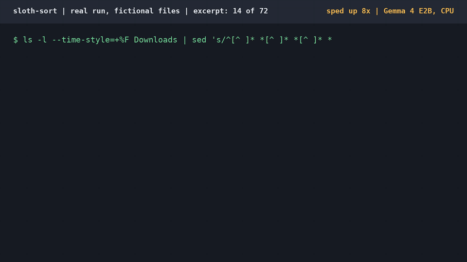

# sloth-sort

A lazy folder tidier that only touches what you have forgotten. **sloth-sort only touches files I have ignored for a week. The lazier I am, the more it tidies; anything I touched recently, it leaves alone, because I might still be using it.** A file counts as touched if it was modified *or opened* in the last 7 days (`--ignored-for 7d`, changeable). For the forgotten files, a 2B open-weight model (Gemma 4 E2B, 4-bit, via llama.cpp) reads each one, picks one of *your* folders, and moves it, slowly and at the lowest CPU priority. It never overwrites or deletes anything, and `sloth undo` puts every file back, byte for byte.

Built by **Harsha Shinde** for the DEV Hacktoberfest Open-Source AI Challenge, Week 3 ("Slow and Steady"). AI-assisted: the code was written with Claude Code (the AI agent also wrote the demo generator and the labels for it). Everything the model sees stays on the machine: no API, no account, $0.



## How it works
1. You write one `sloth.toml`: folder names plus one line saying what belongs in each.
2. `sloth plan ~/Downloads` lists files you have not touched for 7 days, reads them (without changing their access time) and writes a plan. `sloth report` makes a one-page HTML of it, including the files it left alone and why.
3. `sloth apply` moves the files. `sloth undo` reverses it.
4. `sloth run` does plan + apply for a nightly timer (`scripts/install-timer.sh`; untested, I did not install it for this entry).

## Run it (about 5 minutes the first time, CPU only)
```bash
uv venv --python 3.13 .venv && uv pip install --python .venv/bin/python -e ".[dev]"
# llama.cpp release b11555 (CPU build) unpacked to .tools/llama/llama-b11555/, and a Gemma 4 E2B Q4_0 GGUF at models/
scripts/start-model.sh &                                   # serves 127.0.0.1:8187
.venv/bin/python eval/make_downloads_folder.py /tmp/demo/Downloads  # 72 fictional files with old and recent dates
.venv/bin/sloth plan /tmp/demo/Downloads --config eval/downloads.toml
.venv/bin/sloth report /tmp/demo/Downloads   # then open sloth-plan.html
.venv/bin/sloth apply /tmp/demo/Downloads --config eval/downloads.toml
.venv/bin/sloth undo /tmp/demo/Downloads
.venv/bin/python -m pytest -q                              # 21 tests, no model needed
```
With no model running, `sloth plan` falls back to extension rules only and says so.

## What the code decides, not the model
- The model's answer is grammar-constrained JSON, folder name from your list or `leave`.
- Low confidence means the file stays put. Unreadable files (binary) move only on high confidence.
- A `strict` folder (e.g. all `.json` go to `machine-output`) is a rule the model is never asked about, and nothing else may enter that folder.
- Never overwrites (a name clash gets `-1`), skips symlinks, dotfiles and every file touched in the last 7 days, refuses a move if the file changed after the plan, and undo refuses if the moved file was edited since.

## Results (real runs, saved in `eval/results/`)
Fictional Downloads folder (`eval/make_downloads_folder.py`): 72 files, 14 touched in the last 7 days (11 modified lately, 3 modified long ago but opened lately), 58 forgotten. Labels come from the generator, which the AI agent wrote.

| Method (58 forgotten files) | Right moves | Wrong moves | Left, should have moved | Left, correctly |
|---|---|---|---|---|
| Extension rules (no model) | 31 | 16 | 8 | 3 |
| sloth, first prompt | 46 | 8 | 1 | 3 |
| sloth, after the "blind name" prompt | 42 | 0 | 13 | 3 |

Active files (touched in the last 7 days): extension rules would move 14 of 14; sloth moves 0 of 14. The "blind name" prompt tells the model it cannot see images and must answer `leave` unless the file name itself says where it belongs; it was written after seeing the 8 wrong moves on this same folder, so the second row is not an unseen-data number. The end-to-end run with the same final settings gave the same: 42 right, 0 wrong, 13 left. (Before the demo files were renamed to generic names on 21 Oct, the same prompt gave 42/1/12 in the eval and 42/0/13 end to end, so the model is not fully deterministic; those runs are in the git history.) That end-to-end run: plan 9 min 56 s at nice 19 for 58 files (about 10.3 s per file), apply 0.09 s for 42 moves, undo restored all 72 files byte for byte.

## Limits
- Gemma 4 E2B is confidently wrong sometimes (above). It reads only the first ~1,200 characters of each file.
- Folders are decided by what the file says, so two drafts of one post that differ in tone can land differently.
- Images, audio and video are only sorted by name and type, and only with high confidence.
- One model, one language (English) tested. The demo files are templated and easy; the real folder is the better number.
- Per-file time: about 9.7 to 11.3 s (model on 4 CPU threads, other jobs running). Nobody timed a human sorting the same folder, so there is no minutes-saved claim.
- The access-time rule needs a filesystem that records access times (relatime is fine). On `noatime` mounts only modification time counts.

## Layout
`sloth_sort/` code, `tests/`, `eval/` demo generator, config, scorer and saved results, `scripts/` model start, timer, e2e, media, `docs/media/` GIF and screenshots. MIT licence.
